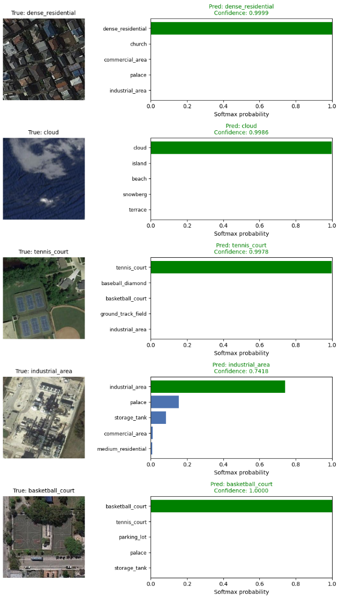
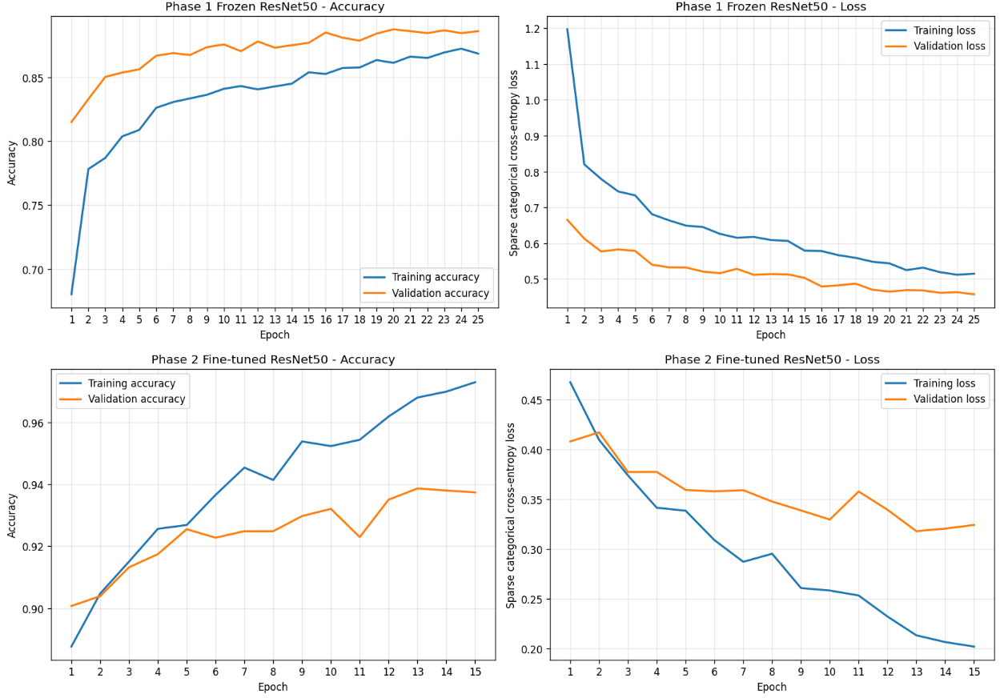
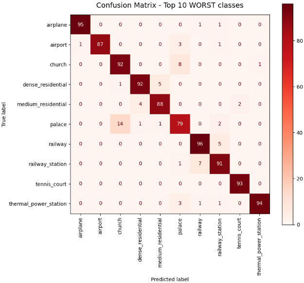

# Remote Sensing Scene Classification (NWPU-RESISC45)

[](https://github.com/esammostafa9-cloud/resisc45-scene-classification/actions/workflows/tests.yml)


Classifies aerial and satellite images into **45 land-use scene categories** using a
**ResNet-50** pretrained on ImageNet, adapted with two-phase transfer learning
(head training → fine-tuning of the top residual stages).

| Metric (held-out test set, 4,725 images) | Score |
|---|---|
| **Accuracy** | **94.41%** |
| Macro precision | 0.9453 |
| Macro recall | 0.9441 |
| Macro F1 | 0.9440 |
| Test loss | 0.2987 |

<p align="center">
  
</p>

---

## Contents

- [Approach](#approach)
- [Results](#results)
- [Project structure](#project-structure)
- [Getting started](#getting-started)
- [Serving and deployment](#serving-and-deployment)
- [Reproducibility](#reproducibility)
- [Author](#author)
- [Dataset and citation](#dataset-and-citation)

## Approach

**Data.** NWPU-RESISC45 has 31,500 RGB images (256×256), 700 per class, 45 classes. The
pipeline verifies the dataset is complete before training, then makes a **stratified
70 / 15 / 15 split** (22,050 / 4,725 / 4,725). The test split is used exactly once, at the end.

**Input pipeline.** Images are decoded and resized to 224×224 with `tf.data`, kept in the raw
0–255 range. ResNet-50's `preprocess_input` runs *inside* the model, after augmentation, so
brightness/contrast augmentation works on real pixel values. Training-only augmentation:
random flips (both axes), rotation (±54°), zoom, translation, contrast and brightness. Overhead
imagery has no fixed orientation, so these transforms create realistic new views.

**Model.**

```
Input (224×224×3, 0–255)
 → augmentation (training only) → ResNet-50 preprocess_input
 → ResNet-50 backbone (ImageNet weights, BatchNorm in inference mode)
 → GlobalAveragePooling → Dropout 0.3
 → Dense 256 (L2 1e-4) → BatchNorm → ReLU → Dropout 0.2
 → Dense 45, softmax
```

**Two-phase training.**

| | Phase 1 – head | Phase 2 – fine-tuning |
|---|---|---|
| Trainable | classification head only | head + `conv4` + `conv5` (BatchNorm frozen) |
| Optimizer / LR | Adam, 1e-3 | Adam, 1e-5 |
| LR schedule | ReduceLROnPlateau ×0.5, patience 2 | ReduceLROnPlateau ×0.3, patience 2 |
| Epoch budget | 25 (early stopping, patience 5) | 15 (early stopping, patience 5) |
| Best val. accuracy | ≈ 0.89 | **≈ 0.94** |

The final model is the phase checkpoint with the higher **validation** accuracy (phase 2). All
hyperparameters live in [`configs/default.yaml`](configs/default.yaml).

## Results

### Training curves



**Phase 1 (top).** With the backbone frozen, validation accuracy climbs steadily and levels off around
0.89. It stays *above* training accuracy throughout, because dropout and augmentation make training
batches harder than the clean validation images.

**Phase 2 (bottom).** Fine-tuning `conv4`/`conv5` lifts validation accuracy from about 0.90 to 0.94,
peaking at epoch 13. Training accuracy keeps rising to about 0.97, so a gap opens, but validation
loss bottoms out at about the same point. The checkpoint from that best validation epoch is the
model that gets kept.

### Per-class performance

Full table: [`results/classification_report.csv`](results/classification_report.csv).

| Strongest classes (F1) | | Weakest classes (F1) | |
|---|---|---|---|
| chaparral | 0.995 | palace | 0.774 |
| ship | 0.995 | church | 0.848 |
| snowberg | 0.991 | medium_residential | 0.867 |
| harbor | 0.986 | railway_station | 0.875 |
| circular_farmland | 0.986 | commercial_area | 0.892 |

Errors are concentrated in classes that genuinely look alike from above. The weakest classes
are confused with each other:



- **palace ↔ church**: 14 palaces were predicted as church and 8 churches as palace (both are
  large ornate buildings). This is the single biggest source of error.
- **railway ↔ railway_station**: 7 + 5 swaps, both being linear rail scenes.
- **dense ↔ medium residential**: housing density shades gradually from one class to the other.

Overall, 264 of the 4,725 test images are misclassified.

The full 45×45 matrix and the 10 best classes are in [`reports/figures/`](reports/figures).

## Project structure

```
├── configs/default.yaml        # all hyperparameters (reproduces the reported result)
├── src/resisc45/
│   ├── config.py               # Config dataclass, YAML loading
│   ├── data.py                 # dataset discovery, verification, split, tf.data pipeline
│   ├── model.py                # ResNet-50 + head, augmentation, fine-tuning unfreeze
│   ├── train.py                # two-phase training CLI
│   ├── evaluate.py             # test metrics, reports, confusion matrices CLI
│   ├── predict.py              # inference CLI for images / folders
│   ├── inference.py            # Classifier: load once, predict from paths or bytes
│   ├── api.py                  # FastAPI REST service
│   ├── hub.py                  # publish model + demo to the Hugging Face Hub
│   ├── visualize.py            # plotting helpers
│   └── utils.py                # seeding, logging, JSON helpers
├── demo/                       # Gradio app, deployed as a Hugging Face Space
├── tests/                      # unit, API, demo and end-to-end tests
├── reports/figures/            # figures from the reported run
├── results/                    # metrics and per-class report from the reported run
├── Dockerfile                  # container for the REST API
└── requirements-api.txt        # extra dependencies for serving
```

## Getting started

### 1. Install

Requires Python 3.10–3.12. A GPU is strongly recommended for training: the reported run used
an NVIDIA A100. CPU is fine for inference.

```bash
git clone https://github.com/esammostafa9-cloud/resisc45-scene-classification.git
cd resisc45-scene-classification
python -m venv .venv
source .venv/bin/activate        # Windows: .venv\Scripts\activate
pip install -r requirements.txt
pip install -e .
```

### 2. Get the dataset

The dataset is **not** included in this repository. Download NWPU-RESISC45 (see
[Dataset and citation](#dataset-and-citation)) and place it under `data/`. Either layout works:

```
data/NWPU-RESISC45/airplane/airplane_001.jpg ...   # extracted folder
data/NWPU.zip                                      # or the archive, extracted on first use
```

The loader walks the tree to find the folder that holds the 45 class folders, so an extra
wrapper folder inside the archive is fine.

### 3. Train

```bash
python -m resisc45.train --data-dir data/NWPU-RESISC45 --config configs/default.yaml
```

Each run writes to `runs/<timestamp>/` (or `--output-dir`):

| File | Contents |
|---|---|
| `model.keras` | selected model (best validation accuracy) |
| `phase1_head_best.keras`, `phase2_finetune_best.keras` | per-phase checkpoints |
| `config.yaml`, `class_names.json`, `split.csv` | everything needed to reproduce / evaluate |
| `history_*.csv`, `history.json`, `selection.json` | training logs and model selection |
| `test_metrics.json`, `classification_report.csv`, `test_predictions.csv` | test results |
| `figures/` | class distribution, training curves, confusion matrices, sample predictions |

Useful flags: `--head-epochs`, `--fine-tune-epochs`, `--batch-size`, `--skip-eval`, and
`--no-verify` (to train on a subset of the classes).

### 4. Evaluate an existing run

```bash
python -m resisc45.evaluate --run-dir runs/<timestamp> --data-dir data/NWPU-RESISC45
```

### 5. Predict

```bash
python -m resisc45.predict --model runs/<timestamp>/model.keras path/to/image.jpg path/to/folder/
```

It prints one row per image with the top-k classes and their probabilities (`--top-k`, default
3). Add `--output predictions.csv` to save the table.

### Tests

```bash
pip install -e ".[dev]"
pytest
```

The tests build a tiny synthetic dataset and a small untrained model, so they need neither the
real data, the ImageNet weights nor network access. They cover the data pipeline, model, the
train → evaluate → predict CLIs, the REST API, the Gradio demo and the Hub upload.

## Serving and deployment

```
 train.py ──► model.keras + class_names.json ──► Hugging Face Hub (model repo)
                                                     │
                         ┌───────────────────────────┴──────────────────────────┐
                         ▼                                                      ▼
            Gradio demo (Hugging Face Space)                  FastAPI service (Docker)
```

Every entry point (CLI, API, demo) uses the same `Classifier` in
[`inference.py`](src/resisc45/inference.py), so images are always preprocessed exactly as in
training. The model is loaded from `RESISC45_MODEL_PATH` if that is set, otherwise from the Hub
repo in `RESISC45_HUB_REPO`.

### Gradio demo

```bash
pip install -e ".[demo]"
RESISC45_MODEL_PATH=runs/<timestamp>/model.keras python demo/app.py   # http://localhost:7860
```

### REST API

```bash
pip install -e ".[api]"
RESISC45_MODEL_PATH=runs/<timestamp>/model.keras python -m resisc45.api
curl -F "file=@demo/examples/harbor.jpg" "http://localhost:8000/predict?top_k=3"
```

Interactive docs are at `http://localhost:8000/docs`.

| Endpoint | Description |
|---|---|
| `GET /health` | liveness check |
| `GET /classes` | the 45 class names |
| `POST /predict?top_k=5` | multipart image upload → label, confidence, top-k probabilities |

### Docker

```bash
docker build -t resisc45-api .
docker run -p 8000:8000 -v "$(pwd)/runs/<timestamp>:/models" resisc45-api
```

The image holds code and dependencies only. The model is mounted at `/models`, or downloaded from
the Hub when you pass `-e RESISC45_MODEL_PATH= -e RESISC45_HUB_REPO=<user>/<repo>`.

### Publish to the Hugging Face Hub

```bash
hf auth login
python -m resisc45.hub model --model runs/<timestamp>/model.keras --repo <hf-user>/resisc45-resnet50
python -m resisc45.hub space --repo <hf-user>/aerial-scene-classifier --model-repo <hf-user>/resisc45-resnet50
```

The first command checks that the model and class names match, then uploads them with a model card
built from [`results/test_metrics.json`](results/test_metrics.json). The second deploys
[`demo/`](demo) as a Gradio Space, which installs this package from GitHub and loads the model
from the Hub.

## Reproducibility

- A single seed (`seed: 42`) controls Python, NumPy and TensorFlow, and the stratified split.
- The exact split is saved to `split.csv` in every run, and evaluation reuses it.
- GPU kernels are not fully deterministic, so re-runs can differ from the reported numbers
  by a few tenths of a percent.

## Author

**Esam Mustafa Ali Abduljalil Al-Areqi** · [@esammostafa9-cloud](https://github.com/esammostafa9-cloud)

## Dataset and citation

NWPU-RESISC45 was created by Northwestern Polytechnical University. It is available through the
authors and from [TensorFlow Datasets](https://www.tensorflow.org/datasets/catalog/resisc45),
which links to the download. Please cite the original paper if you use it:

> G. Cheng, J. Han and X. Lu, "Remote Sensing Image Scene Classification: Benchmark and State
> of the Art," *Proceedings of the IEEE*, vol. 105, no. 10, pp. 1865–1883, 2017.
> doi:10.1109/JPROC.2017.2675998

The dataset images in `reports/figures/` are shown for illustration only and remain subject to
the dataset's own terms.

## License

Code is released under the [MIT License](LICENSE).
