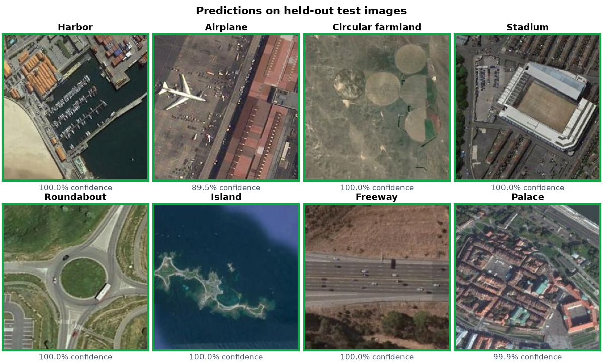
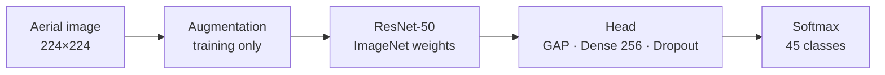

<div align="center">

# Aerial scene classification with ResNet-50

Classifies satellite and aerial images into the 45 land-use classes of NWPU-RESISC45.

[](https://github.com/esammostafa9-cloud/resisc45-scene-classification/actions/workflows/tests.yml)   

[Results](#results) · [Getting started](#getting-started) · [How it works](#how-it-works) · [Project layout](#project-layout)


<sub>The Gradio demo classifying held-out test images with the trained model.</sub>

</div>

An ImageNet-pretrained ResNet-50 is trained in two stages: first only a new classification head,
then the top two residual stages (`conv4`, `conv5`) at a low learning rate. It reaches **94.41%
accuracy** on the 4,725-image test split.

The repo has command-line tools for training, evaluation and prediction, plus a Gradio app to try
the model on your own images.

**Tech stack:** Python · TensorFlow / Keras · scikit-learn · NumPy · pandas · Matplotlib · Gradio ·
pytest · GitHub Actions

## Results

<div align="center">

| Accuracy | Macro F1 | Macro precision | Macro recall | Test loss |
|:---:|:---:|:---:|:---:|:---:|
| **94.41%** | **0.944** | 0.945 | 0.944 | 0.299 |

</div>

<p align="center">
  
</p>

| Training curves | Confusion matrix (10 hardest classes) |
|:---:|:---:|
|  |  |

With the backbone frozen, validation accuracy levels off at about 0.89. Fine-tuning `conv4` and
`conv5` brings it to about 0.94.

Most of the 264 misclassified test images are scenes that look alike from above. Palace and
church are confused most (14 palaces predicted as church, 8 the other way), followed by railway
and railway station (7 and 5), and dense and medium residential.

<details>
<summary><b>Per-class F1</b></summary>

<br>

| Best classes | F1 | Worst classes | F1 |
|---|:---:|---|:---:|
| chaparral | 0.995 | palace | 0.774 |
| ship | 0.995 | church | 0.848 |
| snowberg | 0.991 | medium_residential | 0.867 |
| harbor | 0.986 | railway_station | 0.875 |
| circular_farmland | 0.986 | commercial_area | 0.892 |

All 45 classes are in [`results/classification_report.csv`](results/classification_report.csv).
The full 45×45 confusion matrix is in [`reports/figures/confusion_matrix.png`](reports/figures/confusion_matrix.png).

</details>

## Getting started

You need Python 3.11 and about 4 GB of free disk space. Training on a CPU takes many hours, so
use an NVIDIA GPU if you can. On Windows, TensorFlow can only use the GPU from inside
[WSL2](https://www.tensorflow.org/install/pip#windows-wsl2).

### 1. Install

```bash
git clone https://github.com/esammostafa9-cloud/resisc45-scene-classification.git
cd resisc45-scene-classification
python -m venv .venv
```

Activate the environment. On Windows:

```powershell
.venv\Scripts\activate
```

On macOS or Linux:

```bash
source .venv/bin/activate
```

Then install the dependencies. The `[demo]` part adds Gradio for step 6.

```bash
pip install -r requirements.txt
pip install -e ".[demo]"
```

### 2. Get the dataset

The dataset isn't included in this repo. Download NWPU-RESISC45 from the link on the
[TensorFlow Datasets page](https://www.tensorflow.org/datasets/catalog/resisc45) (about 400 MB),
then extract it into a `data` folder so the class folders sit directly inside it:

```
data/NWPU-RESISC45/
├── airplane/
│   ├── airplane_001.jpg
│   └── ...
├── airport/
└── ... (45 class folders, 700 images each)
```

The download is a `.rar` file, which you can open with 7-Zip or WinRAR. If you have the dataset
as a `.zip`, you can also pass the zip file directly in the next steps; it's extracted on first use.

Before training, the code checks that there are exactly 45 classes with 700 images each, and stops
with an error if anything is missing.

### 3. Train

```bash
python -m resisc45.train --data-dir data/NWPU-RESISC45
```

This runs both training stages and then evaluates the best model on the test split. Everything is
saved to a new folder, `runs/<timestamp>/`:

| File | Contents |
|---|---|
| `model.keras` | the trained model |
| `class_names.json` | class names, in the order the model outputs them |
| `test_metrics.json`, `classification_report.csv` | test accuracy, F1 and per-class scores |
| `figures/` | training curves, confusion matrices, sample predictions |
| `config.yaml`, `split.csv` | the settings and the exact train/val/test split used |

To check your setup quickly before a full run, train one short epoch:

```bash
python -m resisc45.train --data-dir data/NWPU-RESISC45 --head-epochs 1 --fine-tune-epochs 0
```

<details>
<summary><b>More training options</b></summary>

<br>

| Option | What it does |
|---|---|
| `--output-dir runs/my-run` | save to a folder you choose instead of `runs/<timestamp>/` |
| `--config my-config.yaml` | use your own copy of [`configs/default.yaml`](configs/default.yaml) |
| `--head-epochs N`, `--fine-tune-epochs N` | change the epoch budget of each stage |
| `--batch-size N` | lower this if you run out of GPU memory |
| `--skip-eval` | don't evaluate on the test split at the end |
| `--no-verify` | skip the 45 × 700 dataset check, e.g. to train on a subset of the classes |

</details>

### 4. Evaluate

Training already evaluates the model. To re-run the evaluation later, on the same test split:

```bash
python -m resisc45.evaluate --run-dir runs/<timestamp> --data-dir data/NWPU-RESISC45
```

Replace `<timestamp>` with the name of your run folder. The metrics, reports and figures in that
folder are updated.

### 5. Predict on your own images

Pass one or more image files or folders:

```bash
python -m resisc45.predict --model runs/<timestamp>/model.keras my_image.jpg my_folder/
```

It prints the top 3 classes and their probabilities for each image. Add `--top-k 5` to see more
classes, or `--output predictions.csv` to save the results.

### 6. Run the Gradio demo

The demo is the app shown in the GIF at the top. Tell it where your model is, then start it.
On Windows (PowerShell):

```powershell
$env:RESISC45_MODEL_PATH = "runs/<timestamp>/model.keras"
python demo/app.py
```

On macOS or Linux:

```bash
RESISC45_MODEL_PATH=runs/<timestamp>/model.keras python demo/app.py
```

Open the address it prints in your browser. You can upload an image or click one of the 8 built-in
examples.

## How it works



The dataset has 31,500 images, 700 per class, split 70/15/15 with stratification. The test split
is only used once, at the end.

Training images get random flips, rotations, zoom, shifts, and contrast and brightness changes.
Aerial images have no "up", so flipped and rotated copies are still realistic.

ResNet-50's `preprocess_input` is part of the model and runs after augmentation, so the saved
model takes raw 0–255 pixels. The head is global average pooling, Dropout 0.3, Dense 256 with L2
1e-4, BatchNorm, ReLU, Dropout 0.2 and a 45-way softmax.

| | Stage 1: head only | Stage 2: fine-tuning |
|---|---|---|
| Trainable | classification head | head + `conv4` + `conv5` (BatchNorm frozen) |
| Optimizer | Adam, 1e-3 | Adam, 1e-5 |
| LR schedule | ReduceLROnPlateau ×0.5 | ReduceLROnPlateau ×0.3 |
| Epochs | up to 25, early stopping | up to 15, early stopping |
| Best val. accuracy | ≈ 0.89 | ≈ 0.94 |

The stage with the higher validation accuracy is kept as the final model. Every hyperparameter is
in [`configs/default.yaml`](configs/default.yaml).

One seed (`seed: 42`) controls Python, NumPy, TensorFlow and the data split. GPU training isn't
fully deterministic, so repeated runs can differ by a few tenths of a percent. Runs with the
default config have scored between 94.4% and 94.6%.

## Project layout

```
├── configs/default.yaml     # all hyperparameters
├── src/resisc45/
│   ├── data.py              # finding, checking and splitting the dataset; tf.data pipeline
│   ├── model.py             # ResNet-50 + head, augmentation, fine-tuning
│   ├── train.py             # step 3: training
│   ├── evaluate.py          # step 4: evaluation
│   ├── predict.py           # step 5: prediction
│   ├── inference.py         # model loading and preprocessing for prediction and the demo
│   ├── visualize.py         # plotting
│   ├── config.py, utils.py
├── demo/                    # step 6: Gradio app and example images
├── tests/                   # automated tests
├── reports/figures/         # figures for the results above
└── results/                 # per-class report for the results above
```

To run the tests: `pip install -e ".[dev]"`, then `pytest`. They use a tiny synthetic dataset, so
they don't need the real data or a GPU.

## Dataset

NWPU-RESISC45 was created at Northwestern Polytechnical University.

> G. Cheng, J. Han and X. Lu, "Remote Sensing Image Scene Classification: Benchmark and State of
> the Art," *Proceedings of the IEEE*, vol. 105, no. 10, pp. 1865–1883, 2017.
> [doi:10.1109/JPROC.2017.2675998](https://doi.org/10.1109/JPROC.2017.2675998)

## License

The code is released under the [MIT License](LICENSE) and comes without warranty.

The 8 example images and the figures that show them come from NWPU-RESISC45. They're included
for research and educational illustration only, are not covered by the MIT License, and will be
removed on request. Models trained on this dataset should only be used for non-commercial
research and education. Details on the dataset, the pretrained weights and the dependencies are in
[`THIRD_PARTY_NOTICES.md`](THIRD_PARTY_NOTICES.md).

## Author

Esam Mustafa Ali Abduljalil Al-Areqi ([@esammostafa9-cloud](https://github.com/esammostafa9-cloud))
