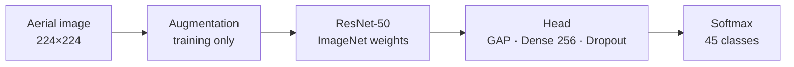
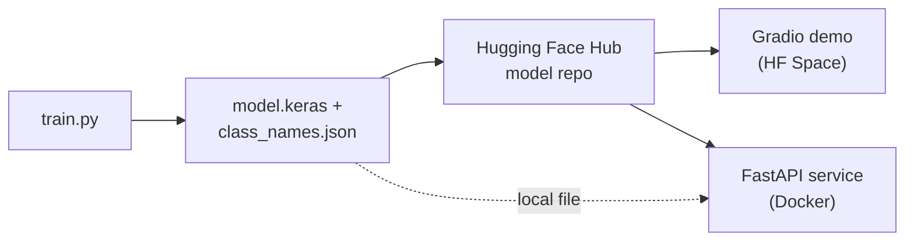

<div align="center">

# Aerial scene classification with ResNet-50

Classifies satellite and aerial images into the 45 land-use classes of NWPU-RESISC45.

[](https://github.com/esammostafa9-cloud/resisc45-scene-classification/actions/workflows/tests.yml)   

[Results](#results) · [Quick start](#quick-start) · [How it works](#how-it-works) · [Serving](#serving) · [Project layout](#project-layout)


<sub>The Gradio demo running locally with the trained model on held-out test images.</sub>

</div>

An ImageNet-pretrained ResNet-50 is trained in two stages: first only a new classification head,
then the top two residual stages (`conv4`, `conv5`) at a low learning rate. It reaches **94.41%
accuracy** on the 4,725-image test split.

The repo also has command-line tools for training, evaluation and prediction, a Gradio demo, a
small FastAPI service and a Dockerfile. All of them use the same inference code. There are 26
tests, and CI runs them along with `ruff` and a Docker build on every push.

## Results

<div align="center">

| Accuracy | Macro F1 | Macro precision | Macro recall | Test loss |
|:---:|:---:|:---:|:---:|:---:|
| **94.41%** | **0.944** | 0.945 | 0.944 | 0.299 |

</div>

<p align="center">
  
</p>

| Training curves | Confusion matrix (10 hardest classes) |
|:---:|:---:|
|  |  |

With the backbone frozen, validation accuracy levels off at about 0.89. Fine-tuning `conv4` and
`conv5` brings it to about 0.94.

Most of the 264 misclassified test images are scenes that look alike from above. Palace and
church are confused most (14 palaces predicted as church, 8 the other way), followed by railway
and railway station (7 and 5), and dense and medium residential.

<details>
<summary><b>Per-class F1</b></summary>

<br>

| Best classes | F1 | Worst classes | F1 |
|---|:---:|---|:---:|
| chaparral | 0.995 | palace | 0.774 |
| ship | 0.995 | church | 0.848 |
| snowberg | 0.991 | medium_residential | 0.867 |
| harbor | 0.986 | railway_station | 0.875 |
| circular_farmland | 0.986 | commercial_area | 0.892 |

All 45 classes are in [`results/classification_report.csv`](results/classification_report.csv).
The full 45×45 confusion matrix is in [`reports/figures/`](reports/figures).

</details>

## Quick start

```bash
git clone https://github.com/esammostafa9-cloud/resisc45-scene-classification.git
cd resisc45-scene-classification
python -m venv .venv && source .venv/bin/activate     # Windows: .venv\Scripts\activate
pip install -r requirements.txt && pip install -e .
```

Classify images with a trained model (`class_names.json` must sit next to the model file):

```bash
python -m resisc45.predict --model models/model.keras path/to/image.jpg path/to/folder/
```

To train from scratch, put the extracted dataset folder or `NWPU.zip` in `data/` (see
[Dataset](#dataset)). Use a GPU; on a CPU this takes many hours.

```bash
python -m resisc45.train --data-dir data/NWPU.zip --config configs/default.yaml
```

<details>
<summary><b>Training outputs and options</b></summary>

<br>

Each run writes to `runs/<timestamp>/`, or to `--output-dir` if you set it:

| File | Contents |
|---|---|
| `model.keras` | selected model (best validation accuracy) |
| `phase1_head_best.keras`, `phase2_finetune_best.keras` | per-phase checkpoints |
| `config.yaml`, `class_names.json`, `split.csv` | what you need to reproduce or re-evaluate the run |
| `history_*.csv`, `history.json`, `selection.json` | training logs and model selection |
| `test_metrics.json`, `classification_report.csv`, `test_predictions.csv` | test results |
| `figures/` | training curves, confusion matrices, sample predictions |

Other flags: `--head-epochs`, `--fine-tune-epochs`, `--batch-size`, `--skip-eval`, and
`--no-verify` to train on a subset of the classes.

To re-evaluate a finished run on its saved test split:

```bash
python -m resisc45.evaluate --run-dir runs/<timestamp> --data-dir data/NWPU.zip
```

</details>

## How it works



The dataset has 31,500 images, 700 per class. It's checked for completeness, then split 70/15/15
with stratification. The test split is only used once, at the end.

Training images get random flips, rotations, zoom, shifts, and contrast and brightness changes.
Aerial images have no "up", so flipped and rotated copies are still realistic.

ResNet-50's `preprocess_input` is part of the model and runs after augmentation, so the saved
model takes raw 0–255 pixels. The head is global average pooling, Dropout 0.3, Dense 256 with L2
1e-4, BatchNorm, ReLU, Dropout 0.2 and a 45-way softmax.

| | Stage 1: head only | Stage 2: fine-tuning |
|---|---|---|
| Trainable | classification head | head + `conv4` + `conv5` (BatchNorm frozen) |
| Optimizer | Adam, 1e-3 | Adam, 1e-5 |
| LR schedule | ReduceLROnPlateau ×0.5 | ReduceLROnPlateau ×0.3 |
| Epochs | up to 25, early stopping | up to 15, early stopping |
| Best val. accuracy | ≈ 0.89 | ≈ 0.94 |

The stage with the higher validation accuracy is kept as the final model. Every hyperparameter is
in [`configs/default.yaml`](configs/default.yaml).

## Serving



The CLI, the API and the demo all go through `Classifier` in
[`inference.py`](src/resisc45/inference.py), so images are preprocessed the same way as in
training. The model is loaded from `RESISC45_MODEL_PATH` if it's set, otherwise from the Hugging
Face repo named in `RESISC45_HUB_REPO`.

<details>
<summary><b>REST API</b></summary>

<br>

```bash
pip install -e ".[api]"
RESISC45_MODEL_PATH=models/model.keras python -m resisc45.api
curl -F "file=@demo/examples/harbor.jpg" "http://localhost:8000/predict?top_k=3"
```

| Endpoint | Description |
|---|---|
| `GET /health` | liveness check |
| `GET /classes` | the 45 class names |
| `POST /predict?top_k=5` | image upload, returns label, confidence and top-k probabilities |

Interactive docs are at `http://localhost:8000/docs`. Files over 10 MB and files that aren't
images get a 413 or 400 response.

</details>

<details>
<summary><b>Docker</b></summary>

<br>

```bash
docker build -t resisc45-api .
docker run -p 8000:8000 -v "$(pwd)/models:/models" resisc45-api
```

The image holds the code and dependencies, not the model, and runs as a non-root user. Mount a
folder containing `model.keras` and `class_names.json` at `/models`, or pull the model from the
Hub with `-e RESISC45_MODEL_PATH= -e RESISC45_HUB_REPO=<user>/<repo>`.

</details>

<details>
<summary><b>Gradio demo and Hugging Face Hub</b></summary>

<br>

Run the demo locally:

```bash
pip install -e ".[demo]"
RESISC45_MODEL_PATH=models/model.keras python demo/app.py     # http://localhost:7860
```

Publish the model, then deploy the demo as a Space:

```bash
hf auth login
python -m resisc45.hub model --model models/model.keras --repo <hf-user>/resisc45-resnet50
python -m resisc45.hub space --repo <hf-user>/aerial-scene-classifier --model-repo <hf-user>/resisc45-resnet50
```

The first command checks that the model and the class names match before uploading them with a
model card built from [`results/test_metrics.json`](results/test_metrics.json).

</details>

## Project layout

<details>
<summary><b>File tree</b></summary>

<br>

```
├── configs/default.yaml     # all hyperparameters
├── src/resisc45/
│   ├── data.py              # finding, checking and splitting the dataset; tf.data pipeline
│   ├── model.py             # ResNet-50 + head, augmentation, fine-tuning
│   ├── train.py             # two-stage training CLI
│   ├── evaluate.py          # metrics, reports, confusion matrices
│   ├── predict.py           # batch prediction CLI
│   ├── inference.py         # Classifier shared by the CLI, API and demo
│   ├── api.py               # FastAPI service
│   ├── hub.py               # Hugging Face Hub publishing
│   ├── visualize.py         # plotting
│   ├── config.py, utils.py
├── demo/                    # Gradio app for a Hugging Face Space
├── tests/                   # data, model, CLI, API, demo and Hub upload tests
├── reports/figures/         # figures for the published model
├── results/                 # metrics and per-class report
└── Dockerfile               # API image
```

</details>

## Testing

```bash
pip install -e ".[dev]"
pytest
```

The tests build a tiny synthetic dataset and an untrained model, so they don't need the real
data, pretrained weights or network access.

One seed (`seed: 42`) controls Python, NumPy, TensorFlow and the data split, and every run saves
its split to `split.csv`. GPU training isn't fully deterministic, so repeated runs can differ by a
few tenths of a percent. Runs with the default config have scored between 94.4% and 94.6%.

## Dataset

NWPU-RESISC45 was created at Northwestern Polytechnical University. You can get it from the
authors or through [TensorFlow Datasets](https://www.tensorflow.org/datasets/catalog/resisc45).
It isn't included here.

> G. Cheng, J. Han and X. Lu, "Remote Sensing Image Scene Classification: Benchmark and State of
> the Art," *Proceedings of the IEEE*, vol. 105, no. 10, pp. 1865–1883, 2017.
> [doi:10.1109/JPROC.2017.2675998](https://doi.org/10.1109/JPROC.2017.2675998)

## License

The code is released under the [MIT License](LICENSE) and comes without warranty.

The 8 example images and the figures that show them come from NWPU-RESISC45. They're included
for research and educational illustration only, are not covered by the MIT License, and will be
removed on request. The trained model is meant for non-commercial research and education. Details
on the dataset, the pretrained weights and the dependencies are in
[`THIRD_PARTY_NOTICES.md`](THIRD_PARTY_NOTICES.md).

## Author

Esam Mustafa Ali Abduljalil Al-Areqi ([@esammostafa9-cloud](https://github.com/esammostafa9-cloud))
