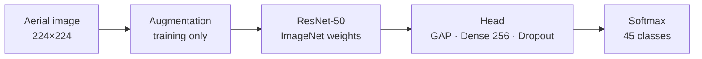
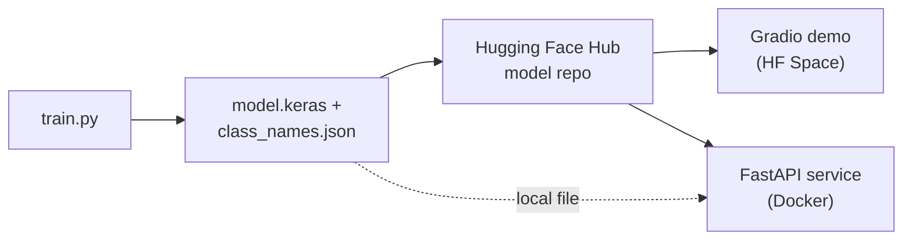

<div align="center">

# 🛰️ Aerial Scene Classification

**Classify satellite and aerial images into 45 land-use scenes with a fine-tuned ResNet-50**

[](https://github.com/esammostafa9-cloud/resisc45-scene-classification/actions/workflows/tests.yml)     

[Results](#-results) · [Quick start](#-quick-start) · [How it works](#-how-it-works) · [Serving](#-serving-and-deployment) · [Project structure](#-project-structure)


</div>

## ✨ Highlights

- **94.4% test accuracy** on NWPU-RESISC45 (45 classes, 4,725 held-out test images)
- **Two-phase transfer learning:** head training on a frozen ResNet-50, then fine-tuning of `conv4`/`conv5`
- **Reproducible:** one YAML config, a fixed seed, and the exact data split saved with every run
- **Production-ready serving:** a Gradio demo, a FastAPI REST service and a Docker image, all sharing
  the same inference code
- **Tested:** 26 tests covering data, model, CLIs, API and demo, plus lint and a Docker build in CI

## 📊 Results

<div align="center">

| Accuracy | Macro F1 | Macro precision | Macro recall | Test loss |
|:---:|:---:|:---:|:---:|:---:|
| **94.41%** | **0.944** | 0.945 | 0.944 | 0.299 |

</div>

| Training curves | Confusion matrix (10 hardest classes) |
|:---:|:---:|
|  |  |

- **Fine-tuning works:** validation accuracy rises from **≈ 0.89** with a frozen backbone to
  **≈ 0.94** after fine-tuning `conv4`/`conv5`.
- **Errors come from look-alike scenes:** *palace* ↔ *church* (14 + 8 swaps), *railway* ↔
  *railway station* (7 + 5), and *dense* ↔ *medium residential*. Overall, 264 of 4,725 test
  images are misclassified.

<details>
<summary><b>Per-class highlights</b></summary>

<br>

| Strongest classes | F1 | Weakest classes | F1 |
|---|:---:|---|:---:|
| chaparral | 0.995 | palace | 0.774 |
| ship | 0.995 | church | 0.848 |
| snowberg | 0.991 | medium_residential | 0.867 |
| harbor | 0.986 | railway_station | 0.875 |
| circular_farmland | 0.986 | commercial_area | 0.892 |

The full per-class table is in [`results/classification_report.csv`](results/classification_report.csv).
More figures, including the full 45×45 confusion matrix, are in [`reports/figures/`](reports/figures).

</details>

## 🚀 Quick start

```bash
git clone https://github.com/esammostafa9-cloud/resisc45-scene-classification.git
cd resisc45-scene-classification
python -m venv .venv && source .venv/bin/activate     # Windows: .venv\Scripts\activate
pip install -r requirements.txt && pip install -e .
```

**Classify images** with a trained model:

```bash
python -m resisc45.predict --model models/model.keras path/to/image.jpg path/to/folder/
```

**Train from scratch.** Put the dataset folder or `NWPU.zip` in `data/` (see
[Dataset](#-dataset-and-citation)). A GPU is strongly recommended.

```bash
python -m resisc45.train --data-dir data/NWPU.zip --config configs/default.yaml
```

<details>
<summary><b>Training outputs and options</b></summary>

<br>

Each run writes to `runs/<timestamp>/` (or `--output-dir`):

| File | Contents |
|---|---|
| `model.keras` | selected model (best validation accuracy) |
| `phase1_head_best.keras`, `phase2_finetune_best.keras` | per-phase checkpoints |
| `config.yaml`, `class_names.json`, `split.csv` | everything needed to reproduce or evaluate the run |
| `history_*.csv`, `history.json`, `selection.json` | training logs and model selection |
| `test_metrics.json`, `classification_report.csv`, `test_predictions.csv` | test results |
| `figures/` | training curves, confusion matrices, sample predictions |

Useful flags: `--head-epochs`, `--fine-tune-epochs`, `--batch-size`, `--skip-eval`, and
`--no-verify` (to train on a subset of the classes).

Re-evaluate a finished run on its saved test split:

```bash
python -m resisc45.evaluate --run-dir runs/<timestamp> --data-dir data/NWPU.zip
```

</details>

## 🧠 How it works



- **Data:** 31,500 images, 700 per class, in a stratified **70 / 15 / 15** split. The dataset is
  verified before training, and the test split is used only once, at the end.
- **Augmentation:** flips, rotations, zoom, shifts, plus contrast and brightness changes. Overhead
  imagery has no fixed orientation, so these transforms create realistic new views.
- **Preprocessing inside the model:** ResNet-50's `preprocess_input` runs after augmentation, so
  the saved model accepts raw 0–255 images directly.
- **Head:** global average pooling → Dropout 0.3 → Dense 256 (L2 1e-4) → BatchNorm → ReLU →
  Dropout 0.2 → softmax.

| | Phase 1: train the head | Phase 2: fine-tune |
|---|---|---|
| Trainable | classification head only | head + `conv4` + `conv5` (BatchNorm frozen) |
| Optimizer | Adam, 1e-3 | Adam, 1e-5 |
| LR schedule | ReduceLROnPlateau ×0.5 | ReduceLROnPlateau ×0.3 |
| Epochs | up to 25, early stopping | up to 15, early stopping |
| Best val. accuracy | ≈ 0.89 | **≈ 0.94** |

The final model is the phase with the higher **validation** accuracy. All hyperparameters live in
[`configs/default.yaml`](configs/default.yaml).

## 🌐 Serving and deployment



The CLI, API and demo all use the same `Classifier` in
[`inference.py`](src/resisc45/inference.py), so images are always preprocessed exactly as in
training. The model is loaded from `RESISC45_MODEL_PATH` if that is set, otherwise from the Hub
repo in `RESISC45_HUB_REPO`.

<details>
<summary><b>REST API</b></summary>

<br>

```bash
pip install -e ".[api]"
RESISC45_MODEL_PATH=models/model.keras python -m resisc45.api
curl -F "file=@demo/examples/harbor.jpg" "http://localhost:8000/predict?top_k=3"
```

| Endpoint | Description |
|---|---|
| `GET /health` | liveness check |
| `GET /classes` | the 45 class names |
| `POST /predict?top_k=5` | image upload → label, confidence and top-k probabilities |

Interactive docs: `http://localhost:8000/docs`. Uploads larger than 10 MB, or files that aren't
images, are rejected with a clear error.

</details>

<details>
<summary><b>Docker</b></summary>

<br>

```bash
docker build -t resisc45-api .
docker run -p 8000:8000 -v "$(pwd)/models:/models" resisc45-api
```

The image contains code and dependencies only and runs as a non-root user. Mount a folder with
`model.keras` and `class_names.json` at `/models`, or download from the Hub with
`-e RESISC45_MODEL_PATH= -e RESISC45_HUB_REPO=<user>/<repo>`.

</details>

<details>
<summary><b>Gradio demo and Hugging Face Hub</b></summary>

<br>

Run the demo locally:

```bash
pip install -e ".[demo]"
RESISC45_MODEL_PATH=models/model.keras python demo/app.py     # http://localhost:7860
```

Publish the model, then deploy the demo as a Space:

```bash
hf auth login
python -m resisc45.hub model --model models/model.keras --repo <hf-user>/resisc45-resnet50
python -m resisc45.hub space --repo <hf-user>/aerial-scene-classifier --model-repo <hf-user>/resisc45-resnet50
```

The first command checks that the model and class names match, then uploads them with a model
card built from [`results/test_metrics.json`](results/test_metrics.json).

</details>

## 📁 Project structure

<details>
<summary><b>Show the file tree</b></summary>

<br>

```
├── configs/default.yaml     # all hyperparameters
├── src/resisc45/
│   ├── data.py              # dataset discovery, verification, split, tf.data pipeline
│   ├── model.py             # ResNet-50 + head, augmentation, fine-tuning
│   ├── train.py             # two-phase training CLI
│   ├── evaluate.py          # metrics, reports, confusion matrices
│   ├── predict.py           # batch inference CLI
│   ├── inference.py         # shared Classifier used by the CLI, API and demo
│   ├── api.py               # FastAPI REST service
│   ├── hub.py               # publish to the Hugging Face Hub
│   ├── visualize.py         # plotting helpers
│   ├── config.py, utils.py
├── demo/                    # Gradio app (Hugging Face Space)
├── tests/                   # 26 tests: data, model, CLIs, API, demo, Hub upload
├── reports/figures/         # figures from the published model
├── results/                 # metrics and per-class report
└── Dockerfile               # REST API image
```

</details>

## 🧪 Testing

```bash
pip install -e ".[dev]"
pytest
```

The tests use a tiny synthetic dataset and a small untrained model, so they need no real data, no
pretrained weights and no network access. CI also runs `ruff` and builds the Docker image on every
push.

**Reproducibility.** A single seed (`seed: 42`) controls Python, NumPy, TensorFlow and the split,
and each run saves its exact split to `split.csv`. GPU kernels aren't fully deterministic, so
re-runs can differ by a few tenths of a percent; runs with the default config have scored 94.4–94.6%.

## 📚 Dataset and citation

NWPU-RESISC45 was created by Northwestern Polytechnical University. It is available through the
authors and from [TensorFlow Datasets](https://www.tensorflow.org/datasets/catalog/resisc45). It
is **not** included in this repository.

> G. Cheng, J. Han and X. Lu, "Remote Sensing Image Scene Classification: Benchmark and State of
> the Art," *Proceedings of the IEEE*, vol. 105, no. 10, pp. 1865–1883, 2017.
> [doi:10.1109/JPROC.2017.2675998](https://doi.org/10.1109/JPROC.2017.2675998)

Dataset images shown in this repository are for illustration only and remain subject to the
dataset's terms.

## 👤 Author

**Esam Mustafa Ali Abduljalil Al-Areqi** · [@esammostafa9-cloud](https://github.com/esammostafa9-cloud)

Code released under the [MIT License](LICENSE).
